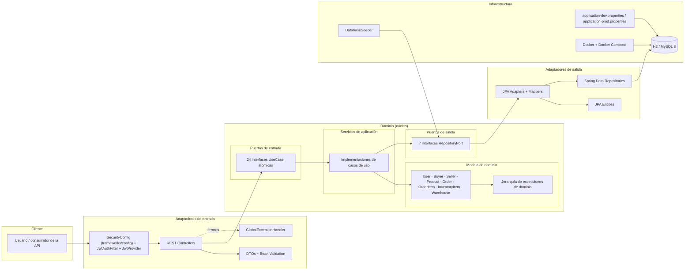
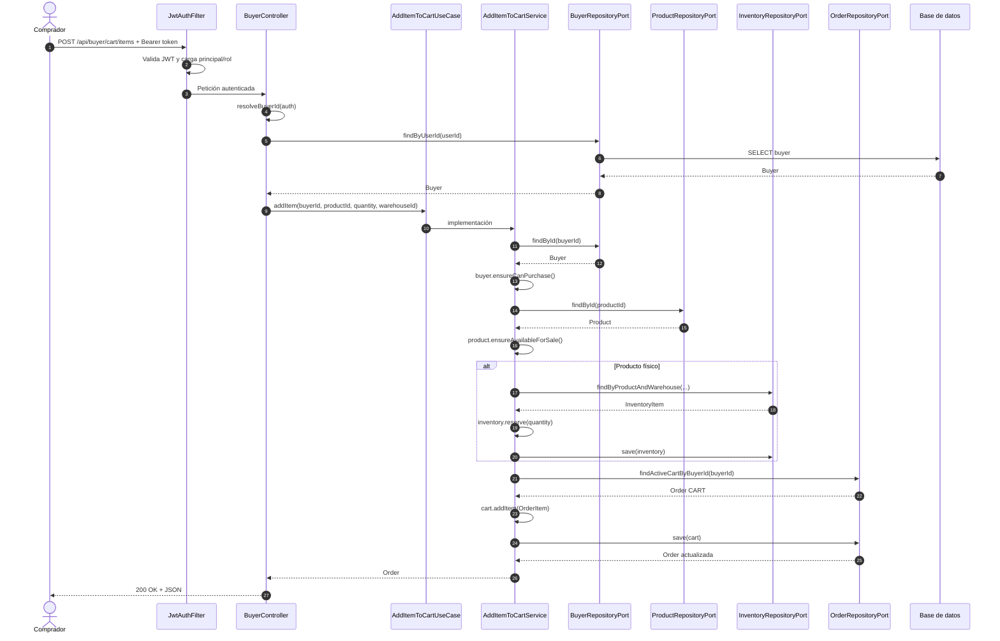
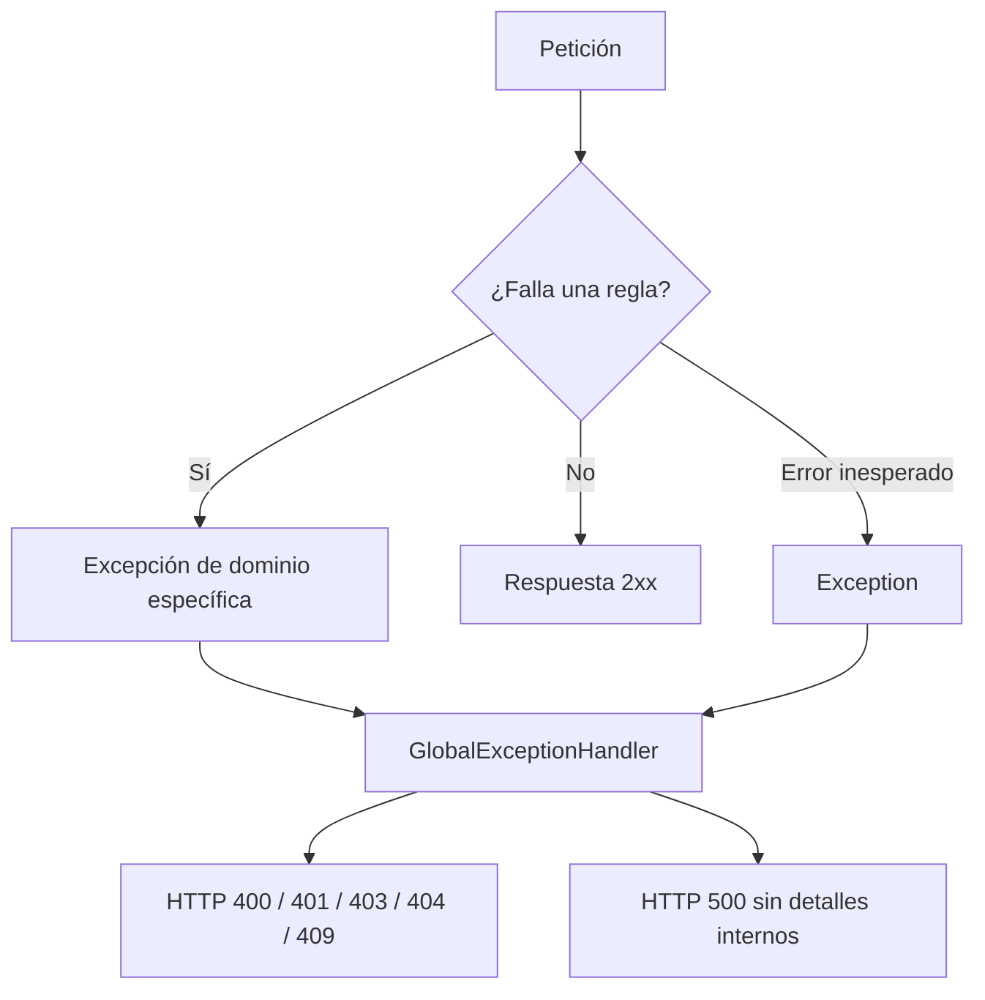

# 02 - Arquitectura

## 1. Visión general

TradeHub usa **Arquitectura Hexagonal**, también conocida como **Ports & Adapters**, y organiza sus
paquetes siguiendo **Clean Architecture**. La idea central es aislar el dominio de todo detalle
tecnológico. El dominio define qué necesita mediante **puertos**; los adaptadores proporcionan las
implementaciones concretas (HTTP, JPA, JWT). La correspondencia entre ambas visiones se detalla en
[06 - Clean Architecture](06-Clean-Architecture.md).

```text
                    ┌─────────────────────────────────────┐
                    │            DOMINIO                 │
                    │  modelos + reglas + excepciones    │
                    │                                     │
   petición HTTP ──▶│  puerto de entrada ──▶ servicio    │
                    │            │                        │
                    │            ▼                        │
                    │  puerto de salida ◀── repositorio  │
                    └────────────┬────────────────────────┘
                                 │ implementado por
                                 ▼
                    ┌─────────────────────────────────────┐
                    │        ADAPTADOR DE SALIDA          │
                    │        JPA / MySQL / H2             │
                    └─────────────────────────────────────┘
```

### Regla de dependencia

Las dependencias siempre apuntan **hacia el dominio**:

```text
adapters/rest ───▶ domain/usecases/ports ───▶ domain/usecases
                                                     │
                                                     ▼
                                              domain/ports/out
                                                     ▲
                                                     │ implementan
                                              adapters/persistence
```

El dominio no importa nada de `adapters`. Los adaptadores sí pueden importar el dominio. Esta es la
inversión de dependencias que hace posible sustituir la base de datos o el transporte sin tocar las
reglas de negocio.

## 2. Diagrama de componentes



### Lectura del diagrama

- **Cliente → Seguridad → Controlador**: toda petición pasa por el filtro JWT y por las reglas de
  autorización por rol.
- **Controlador → puerto de entrada**: el controlador depende de una interfaz pequeña y específica,
  no de una fachada monolítica.
- **Servicio → modelo**: el servicio orquesta; las invariantes las valida el modelo.
- **Servicio → puerto de salida**: el servicio no conoce JPA ni SQL.
- **Adaptador JPA → base de datos**: traduce entre el modelo de dominio y las entidades JPA.
- **Seeder**: usa los mismos puertos de salida, por lo que también respeta la arquitectura.

## 3. Estructura de paquetes

```text
src/main/java/application/
├── TradeHubApplication.java
├── domain/
│   ├── entities/                # Entidades y reglas de negocio
│   │   ├── User.java
│   │   ├── Buyer.java
│   │   ├── Seller.java
│   │   ├── Product.java
│   │   ├── InventoryItem.java
│   │   ├── Warehouse.java
│   │   ├── Order.java
│   │   └── OrderItem.java
│   ├── usecases/                # Capa de casos de uso
│   │   ├── ports/               # 24 puertos de entrada (interfaces UseCase)
│   │   └── *Service.java        # Implementaciones de los casos de uso
│   ├── ports/
│   │   └── out/                 # 7 repositorios abstractos
│   └── exceptions/              # Jerarquía de errores de dominio
├── adapters/                    # Interface Adapters
│   ├── persistence/jpa/         # Adaptadores, entidades, mappers y repos Spring Data
│   ├── rest/
│   │   ├── controllers/         # 6 controladores
│   │   ├── dto/                 # Contratos de entrada
│   │   └── GlobalExceptionHandler.java
│   └── security/                # JwtAuthFilter y JwtProvider
├── frameworks/                  # Frameworks & Drivers
│   └── config/                  # SecurityConfig (configuración de Spring)
└── infrastructure/
    └── seed/                    # Datos iniciales
```

## 4. Capas y responsabilidades

| Capa | Responsabilidad | No debe hacer |
|------|-----------------|---------------|
| **Entidades** (`domain/entities`) | Proteger invariantes, modelar estados y transiciones, lanzar excepciones específicas. | Acceder a base de datos, HTTP o Spring. |
| **Puertos de entrada** (`domain/usecases/ports`) | Declarar operaciones atómicas del negocio. | Contener lógica. |
| **Casos de uso** (`domain/usecases`) | Orquestar entidades y puertos de salida; delimitar transacciones. | Duplicar reglas que ya valida el modelo. |
| **Puertos de salida** (`domain/ports/out`) | Declarar necesidades de persistencia. | Contener SQL o detalles de JPA. |
| **Adaptadores REST** | Traducir HTTP ↔ dominio, resolver identidad y mapear respuestas. | Decidir reglas de negocio. |
| **Adaptadores JPA** | Traducir dominio ↔ entidades y ejecutar consultas. | Filtrar reglas de negocio. |
| **Seguridad** | Autenticar, validar JWT y autorizar por rol. | Decidir si un recurso pertenece a un usuario (eso es dominio). |
| **Frameworks & Drivers** (`frameworks/config`) | Configurar Spring Security y el resto de infraestructura del framework. | Implementar reglas de negocio. |
| **Infraestructura** | Configuración, perfiles, seed y despliegue. | Implementar casos de uso. |

## 5. Flujo de una petición

Ejemplo: `POST /api/buyer/cart/items`.



Si una regla falla, el servicio lanza una excepción de dominio y `GlobalExceptionHandler` la
convierte en el código HTTP correspondiente. El controlador no captura excepciones de negocio.

## 6. Adaptadores de entrada

### 6.1 REST

| Controlador | Ruta base | Responsabilidad |
|-------------|-----------|-----------------|
| `PublicController` | `/api/public` | Registro de compradores e inicio de sesión. |
| `CatalogController` | `/api/catalog` | Consulta pública de productos publicados. |
| `AdminController` | `/api/admin` | Registro/aprobación de vendedores y creación de almacenes. |
| `SellerController` | `/api/seller` | Productos e inventario del vendedor autenticado. |
| `BuyerController` | `/api/buyer` | Carrito, pago y órdenes del comprador autenticado. |
| `LogisticsController` | `/api/logistics` | Transiciones logísticas de la orden. |

Los controladores siguen el mismo patrón:

1. Resolver el identificador del perfil a partir del `Authentication`.
2. Invocar exactamente el caso de uso necesario.
3. Mapear el modelo de dominio a un `Map`/DTO de respuesta.
4. Delegar los errores al handler global.

### 6.2 Seguridad

- `JwtAuthFilter` intercepta cada petición, valida el token y construye el `Authentication`.
- `SecurityConfig` (en `application.frameworks.config`) define rutas públicas y restringe el resto por rol.
- `JwtProvider` firma y valida tokens con `jjwt`.
- La autorización por rol responde **403**; la falta de token responde **401**.

Matriz de acceso:

| Ruta | Público | BUYER | SELLER | LOGISTICS_OPERATOR | ADMINISTRATOR |
|------|---------|-------|--------|--------------------|---------------|
| `/api/public/**` | Sí | Sí | Sí | Sí | Sí |
| `GET /api/catalog/**` | Sí | Sí | Sí | Sí | Sí |
| `/api/buyer/**` | No | Sí | No | No | No |
| `/api/seller/**` | No | No | Sí | No | No |
| `/api/logistics/**` | No | No | No | Sí | No |
| `/api/admin/**` | No | No | No | No | Sí |

## 7. Adaptadores de salida

| Puerto | Adaptador | Responsabilidad |
|--------|-----------|-----------------|
| `UserRepositoryPort` | `UserJpaAdapter` | Persistencia de usuarios. |
| `BuyerRepositoryPort` | `BuyerJpaAdapter` | Persistencia de compradores. |
| `SellerRepositoryPort` | `SellerJpaAdapter` | Persistencia de vendedores. |
| `ProductRepositoryPort` | `ProductJpaAdapter` | Productos y consultas de publicados. |
| `InventoryRepositoryPort` | `InventoryJpaAdapter` | Existencias por producto y almacén. |
| `WarehouseRepositoryPort` | `WarehouseJpaAdapter` | Almacenes. |
| `OrderRepositoryPort` | `OrderJpaAdapter` | Órdenes, carrito activo y consultas por comprador. |

Cada adaptador:

1. Recibe o devuelve modelos de dominio.
2. Convierte con un mapper (`*JpaMapper`).
3. Usa un repositorio Spring Data (`SpringDataJpa*Repository`).
4. No expone entidades JPA fuera de la capa de persistencia.

```text
Order (dominio) ⇄ OrderJpaMapper ⇄ OrderJpaEntity ⇄ SpringDataJpaOrderRepository ⇄ DB
```

## 8. Manejo de errores



El handler es el único punto que conoce la traducción de excepción a HTTP. Esto evita repetir
`try/catch` en cada controlador y mantiene una sola responsabilidad.

## 9. Configuración y despliegue

| Perfil | Base de datos | Uso |
|--------|---------------|-----|
| `dev` | H2 en memoria | Desarrollo local y pruebas. |
| `prod` | MySQL 8 | Docker Compose con volumen persistente. |

Componentes de despliegue:

- `Dockerfile` multi-stage (build + runtime).
- `docker-compose.yml` con la aplicación y MySQL.
- Variables de entorno para credenciales y `JWT_SECRET`.
- `DatabaseSeeder` crea usuarios y datos de demostración al arrancar.

## 10. Decisiones de arquitectura

| Decisión | Motivo | Consecuencia |
|----------|--------|--------------|
| Dominio sin dependencias de Spring/JPA | Proteger reglas y facilitar pruebas. | Se necesitan mappers y entidades JPA separadas. |
| Un puerto de entrada por caso de uso | Cumplir ISP y SRP. | Más interfaces, pero clientes mínimos y claros. |
| Puertos de salida por agregado | Invertir dependencias de persistencia. | Cambiar de BD no afecta servicios. |
| Excepciones específicas | Comunicar la causa exacta y mapear HTTP correctamente. | Más clases, pero errores precisos y testeables. |
| DTOs y mappers en REST | No exponer el modelo interno. | Un poco de código de traducción. |
| Seguridad por rol en rutas + propiedad en dominio | Defensa en profundidad. | Dos niveles de control complementarios. |
