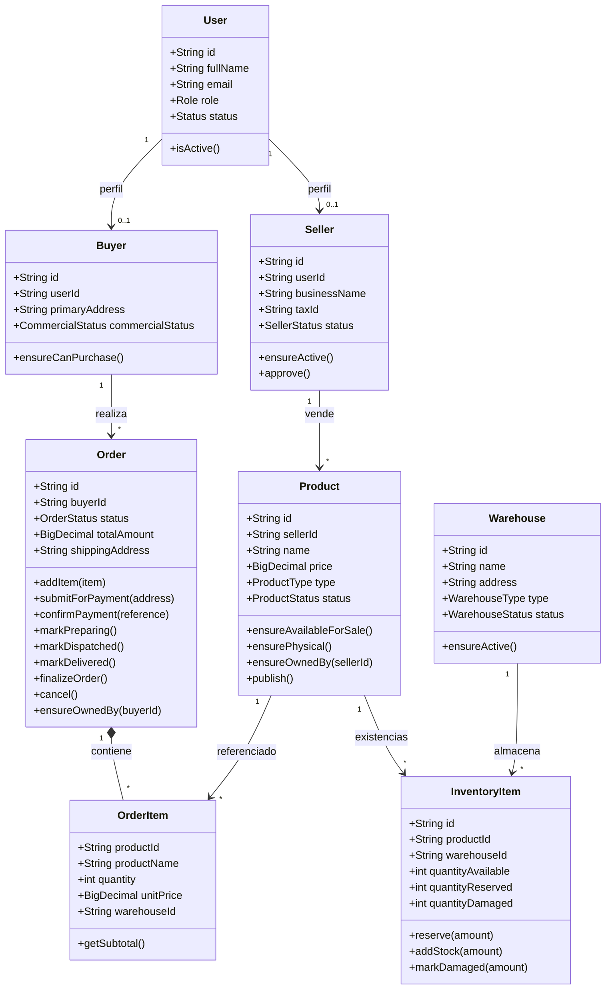
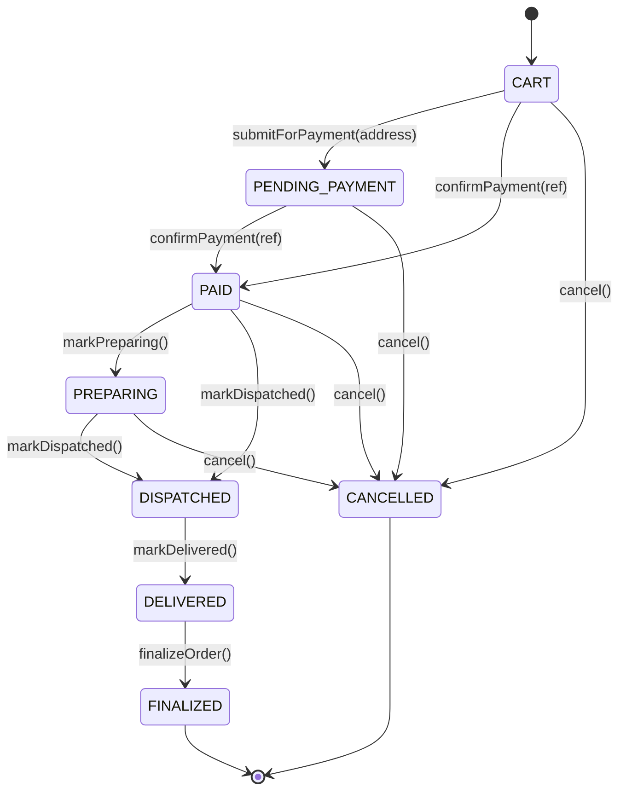
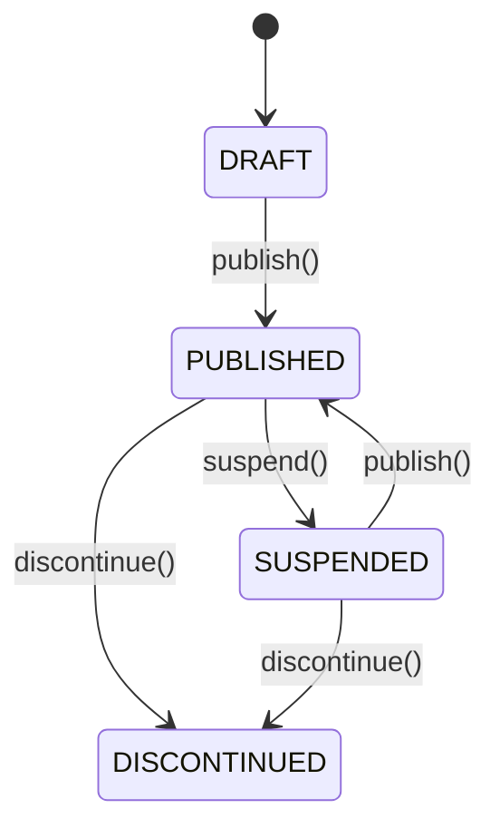
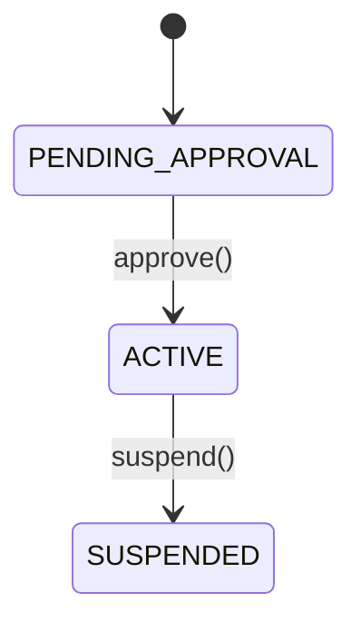
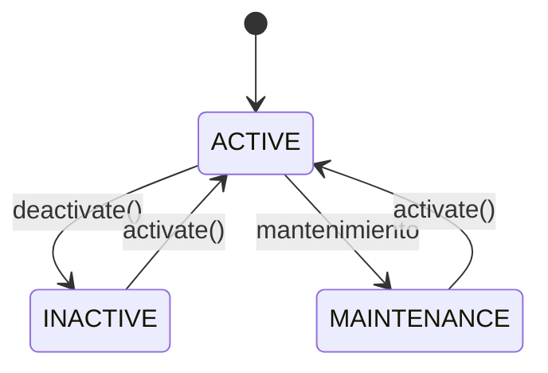

# 03 - Dominio

## 1. Principio rector

El dominio es el corazón del sistema. Contiene las entidades, las reglas que las gobiernan y las
excepciones que comunican su incumplimiento. **No depende de Spring, JPA, HTTP ni JWT.**

Las reglas se validan en el propio modelo mediante métodos `ensure*()` y constructores que rechazan
estados inválidos. Los servicios de aplicación se limitan a orquestar: buscar, invocar la regla,
persistir y devolver.

## 2. Modelo de dominio



> Las relaciones `Product → OrderItem` e `InventoryItem → Product` son por identificador en el
> modelo de dominio; los adaptadores JPA son quienes materializan las claves foráneas.

## 3. Entidades

### 3.1 `User`

Representa la identidad de acceso.

| Atributo | Tipo | Regla |
|----------|------|-------|
| `id` | `String` | UUID generado si no se proporciona. |
| `fullName` | `String` | Obligatorio. |
| `email` | `String` | Obligatorio y único a nivel de aplicación. |
| `passwordHash` | `String` | Hash BCrypt; nunca texto plano. |
| `role` | `Role` | `BUYER`, `SELLER`, `LOGISTICS_OPERATOR`, `ADMINISTRATOR`, `SUPERVISOR`. |
| `status` | `Status` | `ACTIVE`, `BLOCKED`, `INACTIVE`. |

Métodos: `block()`, `activate()`, `deactivate()`, `changePassword()`, `isActive()`.

### 3.2 `Buyer`

Perfil comercial del comprador.

| Atributo | Tipo | Regla |
|----------|------|-------|
| `id` | `String` | UUID. |
| `userId` | `String` | Obligatorio; enlaza con `User`. |
| `primaryAddress` | `String` | Obligatoria. |
| `additionalAddresses` | `List<String>` | Lista mutable controlada. |
| `commercialStatus` | `CommercialStatus` | `ACTIVE`, `SUSPENDED`, `RESTRICTED`. |

Regla: solo un comprador `ACTIVE` puede comprar.

```java
public void ensureCanPurchase() {
  if (!canPurchase()) {
    throw new BuyerCannotPurchaseException(id, commercialStatus.name());
  }
}
```

### 3.3 `Seller`

Perfil comercial del vendedor.

| Atributo | Tipo | Regla |
|----------|------|-------|
| `id` | `String` | UUID. |
| `userId` | `String` | Obligatorio. |
| `businessName` | `String` | Obligatorio. |
| `taxId` | `String` | Identificación tributaria. |
| `status` | `SellerStatus` | `PENDING_APPROVAL`, `ACTIVE`, `SUSPENDED`. |
| `contactPhone` | `String` | Teléfono de contacto. |

Regla: solo un vendedor `ACTIVE` puede crear productos o gestionar inventario.

```java
public void ensureActive() {
  if (!isActive()) {
    throw new SellerNotApprovedException(id, status.name());
  }
}
```

### 3.4 `Product`

Artículo del catálogo.

| Atributo | Tipo | Regla |
|----------|------|-------|
| `id` | `String` | UUID. |
| `sellerId` | `String` | Obligatorio; propietario. |
| `name` | `String` | No vacío. |
| `description` | `String` | Opcional. |
| `type` | `ProductType` | `PHYSICAL` o `DIGITAL`. |
| `price` | `BigDecimal` | Mayor que cero. |
| `status` | `ProductStatus` | `DRAFT`, `PUBLISHED`, `SUSPENDED`, `DISCONTINUED`. |
| `variants` | `List<String>` | Variantes opcionales. |
| `sku` | `String` | Código de referencia. |

El constructor y los setters validan nombre, precio y tipo. `parseType()` convierte el texto de la
API en enum y lanza `InvalidProductTypeException` si no es válido.

```java
public static ProductType parseType(String rawType) {
  if (rawType == null || rawType.isBlank()) {
    throw new InvalidProductTypeException(rawType);
  }
  try {
    return ProductType.valueOf(rawType.trim().toUpperCase(Locale.ROOT));
  } catch (IllegalArgumentException ex) {
    throw new InvalidProductTypeException(rawType);
  }
}
```

Reglas de venta:

- Solo se vende si `status == PUBLISHED`.
- Solo los productos `PHYSICAL` requieren inventario.
- Solo el vendedor propietario puede publicarlo o modificar su inventario.

### 3.5 `Warehouse`

Almacén físico o lógico.

| Atributo | Tipo | Regla |
|----------|------|-------|
| `id` | `String` | UUID. |
| `name` | `String` | Obligatorio. |
| `address` | `String` | Obligatoria. |
| `type` | `WarehouseType` | `MARKETPLACE` o `SELLER`. |
| `status` | `WarehouseStatus` | `ACTIVE`, `INACTIVE`, `MAINTENANCE`. |
| `sellerId` | `String` | Presente solo en almacenes de vendedor. |
| `operatorUserId` | `String` | Operador asignado. |

Regla: solo un almacén `ACTIVE` puede recibir stock.

### 3.6 `InventoryItem`

Existencias de un producto en un almacén.

| Campo | Descripción |
|-------|-------------|
| `quantityAvailable` | Unidades listas para vender. |
| `quantityReserved` | Unidades apartadas por carritos. |
| `quantityDamaged` | Unidades no vendibles. |

Invariantes:

- Ninguna cantidad puede ser negativa (el constructor normaliza a cero).
- `reserve(amount)` exige `amount > 0` y `quantityAvailable >= amount`.
- `addStock(amount)` rechaza cantidades negativas.
- `markDamaged(amount)` no puede exceder lo disponible.

```java
public void reserve(int amount) {
  if (amount <= 0) throw new InvalidQuantityException("Reservation amount must be positive");
  if (quantityAvailable < amount) {
    throw new InsufficientStockException(productId, amount, quantityAvailable);
  }
  this.quantityAvailable -= amount;
  this.quantityReserved += amount;
}
```

### 3.7 `Order`

Carrito u orden de compra. Es el agregado principal del flujo comercial.

| Atributo | Tipo | Regla |
|----------|------|-------|
| `id` | `String` | UUID. |
| `buyerId` | `String` | Obligatorio; propietario. |
| `status` | `OrderStatus` | Ver máquina de estados. |
| `items` | `List<OrderItem>` | Se recalcula el total al modificar. |
| `totalAmount` | `BigDecimal` | Suma de subtotales. |
| `shippingAddress` | `String` | Obligatoria al enviar a pago. |
| `paymentReference` | `String` | Referencia del pago simulado. |

### 3.8 `OrderItem`

Línea de la orden.

| Atributo | Regla |
|----------|-------|
| `productId` | Obligatorio. |
| `productName` | Copia del nombre al momento de comprar. |
| `quantity` | Mayor que cero. |
| `unitPrice` | Obligatorio; precio congelado al agregar. |
| `warehouseId` | Almacén de origen para productos físicos. |

`getSubtotal()` multiplica `unitPrice × quantity`.

## 4. Máquinas de estado

### 4.1 Orden



Reglas de transición:

| Operación | Estados permitidos | Excepción si falla |
|-----------|--------------------|--------------------|
| `confirmPayment` | `PENDING_PAYMENT` | `InvalidPaymentReferenceException` si falta la referencia; `OrderAlreadyPaidException` si ya está pagada; `OrderNotPendingException` en otro estado. |
| `markPreparing` | `PAID` | `OrderNotPreparableException` |
| `markDispatched` | `PAID`, `PREPARING` | `OrderNotDispatchableException` |
| `markDelivered` | `DISPATCHED` | `OrderNotDeliverableException` |
| `finalizeOrder` | `DELIVERED` | `OrderNotFinalizableException` |
| `cancel` | Cualquiera excepto `FINALIZED`, `DISPATCHED`, `DELIVERED` | `OrderNotCancellableException` |
| `submitForPayment` | `CART` con items y dirección | `OrderNotSubmittableException`, `EmptyCartException`, `ShippingAddressRequiredException` |
| `addItem`, `removeItem`, `clearItems` | No `FINALIZED` ni `CANCELLED` | `OrderNotModifiableException` |

### 4.2 Producto



### 4.3 Vendedor



### 4.4 Almacén



## 5. Reglas de negocio y excepciones

| # | Regla | Dónde se protege | Excepción |
|---|-------|------------------|-----------|
| 1 | El email no puede repetirse. | `EmailUniquenessValidator` | `DuplicateEmailException` |
| 2 | Las credenciales deben ser válidas y el usuario estar activo. | `LoginService` | `InvalidCredentialsException` |
| 3 | Un comprador suspendido no puede comprar. | `Buyer.ensureCanPurchase()` | `BuyerCannotPurchaseException` |
| 4 | Un vendedor no aprobado no puede vender. | `Seller.ensureActive()` | `SellerNotApprovedException` |
| 5 | Solo un almacén activo recibe stock. | `Warehouse.ensureActive()` | `WarehouseNotActiveException` |
| 6 | El nombre del producto no puede estar vacío. | `Product` | `InvalidProductNameException` |
| 7 | El precio debe ser mayor que cero. | `Product` | `InvalidProductPriceException` |
| 8 | El tipo debe ser `PHYSICAL` o `DIGITAL`. | `Product.parseType()` | `InvalidProductTypeException` |
| 9 | Solo se venden productos publicados. | `Product.ensureAvailableForSale()` | `ProductNotAvailableException` |
| 10 | Los productos digitales no usan inventario. | `Product.ensurePhysical()` | `ProductNotPhysicalException` |
| 11 | Solo el dueño puede operar su producto. | `Product.ensureOwnedBy()` | `ProductOwnershipException` |
| 12 | Solo el comprador dueño puede operar su orden. | `Order.ensureOwnedBy()` | `OrderOwnershipException` |
| 13 | La cantidad debe ser positiva. | `OrderItem`, `InventoryItem` | `InvalidQuantityException` |
| 14 | No se puede reservar más stock del disponible. | `InventoryItem.reserve()` | `InsufficientStockException` |
| 15 | No se puede modificar una orden finalizada o cancelada. | `Order.ensureModifiable()` | `OrderNotModifiableException` |
| 16 | No se puede pagar una orden ya pagada. | `Order.confirmPayment()` | `OrderAlreadyPaidException` |
| 17 | Las transiciones logísticas son secuenciales. | `Order.mark*()` | `OrderNotPreparableException`, `OrderNotDispatchableException`, `OrderNotDeliverableException`, `OrderNotFinalizableException` |
| 18 | No se puede cancelar una orden despachada, entregada o finalizada. | `Order.cancel()` | `OrderNotCancellableException` |
| 19 | No se puede enviar a pago un carrito vacío. | `Order.submitForPayment()` | `EmptyCartException` |
| 20 | Se requiere dirección de envío. | `Order.submitForPayment()` | `ShippingAddressRequiredException` |
| 21 | La referencia de pago es obligatoria. | `Order.confirmPayment()` | `InvalidPaymentReferenceException` |
| 22 | Solo se paga una orden pendiente de pago. | `Order.confirmPayment()` | `OrderNotPendingException` |
| 23 | Debe existir stock disponible en el almacén. | `InventoryItem.reserve()`, `AddItemToCartService` | `ProductOutOfStockException` |
| 24 | No se liberan ni venden más unidades reservadas de las existentes. | `InventoryItem.releaseReservation()`, `confirmSale()` | `ReservationExceedsReservedException` |
| 25 | No se repite la transición al estado actual. | `User`, `Buyer`, `Seller`, `Warehouse`, `Product` | `UserAlready*Exception`, `BuyerAlready*Exception`, `SellerAlready*Exception`, `WarehouseAlready*Exception`, `ProductAlready*Exception` |
| 26 | Un producto discontinuado no se publica. | `Product.publish()` | `ProductNotPublishableException` |
| 27 | El ítem de orden requiere precio unitario positivo. | `OrderItem` | `InvalidOrderItemPriceException` |
| 28 | Los productos físicos requieren almacén. | `AddItemToCartService` | `WarehouseRequiredException` |
| 29 | Los datos maestros obligatorios no pueden estar vacíos. | `User`, `Buyer`, `Seller`, `Warehouse` | `InvalidUserNameException`, `InvalidPasswordException`, `BuyerAddressRequiredException`, `InvalidSellerBusinessNameException`, `InvalidWarehouseNameException`, `InvalidWarehouseAddressException` |
| 30 | Un almacén de vendedor requiere un vendedor existente y activo. | `RegisterSellerWarehouseService` | `SellerRequiredForWarehouseException`, `SellerNotFoundException`, `SellerNotApprovedException` |
| 31 | No se elimina un producto que no pertenece a la orden. | `Order.removeItem()` | `OrderItemNotFoundException` |
| 32 | El estado de usuario es obligatorio. | `ChangeUserStatusService` | `InvalidUserStatusException` |

## 6. Jerarquía de excepciones

```mermaid
classDiagram
  RuntimeException <|-- DomainException
  DomainException <|-- ResourceNotFoundException
  DomainException <|-- UnauthorizedOperationException
  DomainException <|-- InvalidCredentialsException
  DomainException <|-- DuplicateEmailException
  DomainException <|-- InvalidQuantityException
  DomainException <|-- InsufficientStockException
  DomainException <|-- InvalidProductNameException
  DomainException <|-- InvalidProductPriceException
  DomainException <|-- InvalidProductTypeException
  DomainException <|-- ProductNotAvailableException
  DomainException <|-- ProductNotPhysicalException
  DomainException <|-- OrderAlreadyPaidException
  DomainException <|-- OrderNotPayableException
  DomainException <|-- OrderNotPreparableException
  DomainException <|-- OrderNotDispatchableException
  DomainException <|-- OrderNotDeliverableException
  DomainException <|-- OrderNotFinalizableException
  DomainException <|-- OrderNotCancellableException
  DomainException <|-- OrderNotSubmittableException
  DomainException <|-- OrderNotModifiableException
  DomainException <|-- EmptyCartException
  DomainException <|-- ShippingAddressRequiredException
  DomainException <|-- InvalidPaymentReferenceException
  DomainException <|-- OrderNotPendingException
  DomainException <|-- InvalidOrderItemPriceException
  DomainException <|-- ProductOutOfStockException
  DomainException <|-- ReservationExceedsReservedException
  DomainException <|-- WarehouseRequiredException
  DomainException <|-- UserAlreadyActiveException
  DomainException <|-- UserAlreadyBlockedException
  DomainException <|-- UserAlreadyInactiveException
  DomainException <|-- InvalidUserStatusException
  DomainException <|-- InvalidPasswordException
  DomainException <|-- InvalidUserNameException
  DomainException <|-- SellerAlreadyApprovedException
  DomainException <|-- SellerAlreadySuspendedException
  DomainException <|-- InvalidSellerBusinessNameException
  DomainException <|-- SellerRequiredForWarehouseException
  DomainException <|-- WarehouseAlreadyActiveException
  DomainException <|-- WarehouseAlreadyInactiveException
  DomainException <|-- InvalidWarehouseNameException
  DomainException <|-- InvalidWarehouseAddressException
  DomainException <|-- ProductAlreadyPublishedException
  DomainException <|-- ProductAlreadySuspendedException
  DomainException <|-- ProductAlreadyDiscontinuedException
  DomainException <|-- ProductNotPublishableException
  DomainException <|-- BuyerAlreadyActiveException
  DomainException <|-- BuyerAlreadySuspendedException
  DomainException <|-- BuyerAddressRequiredException

  ResourceNotFoundException <|-- OrderItemNotFoundException
  ResourceNotFoundException <|-- UserNotFoundException
  ResourceNotFoundException <|-- BuyerNotFoundException
  ResourceNotFoundException <|-- SellerNotFoundException
  ResourceNotFoundException <|-- ProductNotFoundException
  ResourceNotFoundException <|-- WarehouseNotFoundException
  ResourceNotFoundException <|-- OrderNotFoundException
  ResourceNotFoundException <|-- CartNotFoundException

  UnauthorizedOperationException <|-- BuyerCannotPurchaseException
  UnauthorizedOperationException <|-- SellerNotApprovedException
  UnauthorizedOperationException <|-- ProductOwnershipException
  UnauthorizedOperationException <|-- OrderOwnershipException
```



La jerarquía permite dos niveles de tratamiento:

1. **Específico**: el servicio o el test sabe exactamente qué regla falló.
2. **Genérico**: `GlobalExceptionHandler` agrupa por familia y asigna el HTTP correcto.

## 7. Servicios de dominio

El único servicio de dominio puro es `EmailUniquenessValidator`:

```java
@Component
public class EmailUniquenessValidator {
  private final UserRepositoryPort userRepository;

  public void ensureAvailable(String email) {
    if (userRepository.existsByEmail(email)) {
      throw new DuplicateEmailException(email);
    }
  }
}
```

Se extrajo para que `RegisterBuyerService` y `RegisterSellerService` no mezclen la validación de
unicidad con la orquestación del registro. Es un colaborador pequeño, reutilizable y con una sola
razón de cambio.

## 8. Servicios de aplicación

Los servicios de aplicación implementan un puerto de entrada. Su patrón es siempre el mismo:

```text
1. Buscar la entidad por id (o lanzar *NotFoundException).
2. Invocar el método de dominio que valida y muta el estado.
3. Persistir con el puerto de salida.
4. Devolver la entidad actualizada.
```

Ejemplo (`CreateProductService`):

```java
@Override
@Transactional
public Product execute(
    String sellerId,
    String name,
    String description,
    Product.ProductType type,
    BigDecimal price,
    String sku) {
  Seller seller =
      sellerRepository.findById(sellerId)
          .orElseThrow(() -> new SellerNotFoundException(sellerId));
  seller.ensureActive();
  return productRepository.save(Product.create(sellerId, name, description, type, price, sku));
}
```

El servicio no valida el precio ni el nombre: eso lo hace `Product`. No valida el estado del
vendedor con un `if` local: lo hace `Seller`. El servicio solo coordina.

## 9. Persistencia y pureza del dominio

El dominio no contiene anotaciones JPA. Las entidades persistentes viven en
`adapters/persistence/jpa/entities`, y los mappers convierten en ambos sentidos. Esto evita que una
decisión de base de datos (por ejemplo, una relación `@ManyToOne`) contamine el modelo.

```text
domain.Product  ⇄  ProductJpaMapper  ⇄  ProductJpaEntity
```

La separación tiene un costo (más clases), pero permite probar el dominio sin contexto de Spring y
cambiar de motor de base de datos sin tocar las reglas.
