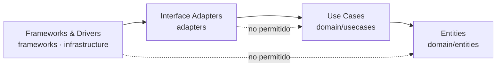
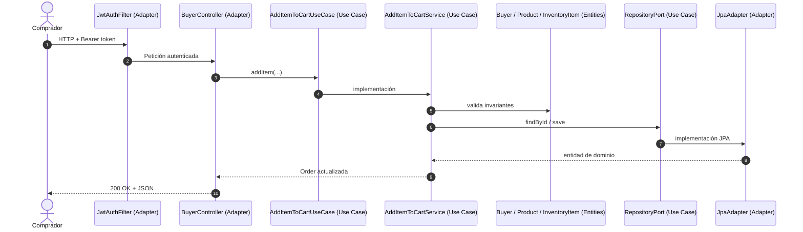

# 06 - Clean Architecture

## 1. Introducción

TradeHub implementa **Clean Architecture** además de la Arquitectura Hexagonal. Ambas comparten la
misma idea central: las reglas de negocio deben vivir en el centro del sistema y no pueden depender
de frameworks, bases de datos ni del transporte HTTP. La Arquitectura Hexagonal describe **cómo**
entra y sale una petición mediante puertos y adaptadores; Clean Architecture describe **cómo se
organizan las capas** y en qué dirección pueden apuntar las dependencias.

La estructura de paquetes del proyecto refleja explícitamente las cuatro capas propuestas por
Robert C. Martin:

```text
┌─────────────────────────────────────────────────────────────┐
│                 Frameworks & Drivers                        │
│  frameworks/config · infrastructure/seed · JPA · JWT · HTTP │
│  ┌───────────────────────────────────────────────────────┐  │
│  │              Interface Adapters                       │  │
│  │  adapters/rest · adapters/persistence · adapters/security │
│  │  ┌─────────────────────────────────────────────────┐  │  │
│  │  │                 Use Cases                       │  │  │
│  │  │  domain/usecases · domain/usecases/ports        │  │  │
│  │  │  ┌───────────────────────────────────────────┐  │  │  │
│  │  │  │                Entities                   │  │  │  │
│  │  │  │  domain/entities · domain/exceptions      │  │  │  │
│  │  │  └───────────────────────────────────────────┘  │  │  │
│  │  └─────────────────────────────────────────────────┘  │  │
│  └───────────────────────────────────────────────────────┘  │
└─────────────────────────────────────────────────────────────┘
```

## 2. Las cuatro capas

### 2.1 Entities (Entidades)

**Ubicación:** `src/main/java/application/domain/entities/` y
`src/main/java/application/domain/exceptions/`.

Contienen los objetos de negocio y las reglas que siempre deben cumplirse, independientemente de si
la aplicación se usa por HTTP, por consola o desde una prueba unitaria. Son clases Java puras, sin
anotaciones de Spring ni de JPA.

| Elemento | Responsabilidad |
|----------|-----------------|
| `User`, `Buyer`, `Seller` | Identidad, rol y estado de los participantes. |
| `Product` | Catálogo, tipo de producto y disponibilidad para la venta. |
| `InventoryItem` | Existencias por producto y almacén; impide stock negativo. |
| `Warehouse` | Almacenes de vendedor y de marketplace. |
| `Order`, `OrderItem` | Carrito, líneas de pedido y máquina de estados de la orden. |
| `domain/exceptions` | Excepciones específicas del negocio (`InsufficientStockException`, `InvalidOrderStateException`, etc.). |

Las entidades no conocen casos de uso, controladores, repositorios ni frameworks. Cuando una regla
se incumple, lanzan una excepción de dominio que posteriormente se traduce a HTTP.

```java
public void reserve(int quantity) {
  if (quantity > availableQuantity) {
    throw new InsufficientStockException(quantity, availableQuantity);
  }
  availableQuantity -= quantity;
}
```

### 2.2 Use Cases (Casos de Uso)

**Ubicación:** `src/main/java/application/domain/usecases/` y
`src/main/java/application/domain/usecases/ports/`.

Esta capa contiene la lógica de aplicación: coordina entidades y puertos de salida para ejecutar una
operación del negocio. No sabe si los datos llegan por REST o si se guardan en MySQL; solo depende de
abstracciones.

| Elemento | Responsabilidad |
|----------|-----------------|
| `domain/usecases/ports/*UseCase` | Puertos de entrada: una interfaz atómica por operación. |
| `domain/usecases/*Service` | Implementación del caso de uso; orquesta entidades y repositorios. |
| `domain/ports/out/*RepositoryPort` | Puertos de salida que los casos de uso necesitan para persistir. |

Cada caso de uso implementa exactamente un puerto de entrada. Por ejemplo,
`AddItemToCartService` implementa `AddItemToCartUseCase` y utiliza `BuyerRepositoryPort`,
`ProductRepositoryPort`, `InventoryRepositoryPort` y `OrderRepositoryPort`.

```java
@Service
public class AddItemToCartService implements AddItemToCartUseCase {

  private final BuyerRepositoryPort buyers;
  private final ProductRepositoryPort products;
  private final InventoryRepositoryPort inventory;
  private final OrderRepositoryPort orders;

  @Override
  public Order addItem(Long buyerId, Long productId, int quantity, Long warehouseId) {
    Buyer buyer = buyers.findById(buyerId).orElseThrow(...);
    buyer.ensureCanPurchase();
    Product product = products.findById(productId).orElseThrow(...);
    product.ensureAvailableForSale();
    // ... reserva de inventario y actualización del carrito
    return orders.save(cart);
  }
}
```

La anotación `@Service` es el único detalle de framework presente en esta capa; se usa únicamente
para que Spring construya el grafo de dependencias. La lógica sigue siendo independiente del
framework y se prueba con dobles de prueba de los puertos.

### 2.3 Interface Adapters (Adaptadores de Interfaz)

**Ubicación:** `src/main/java/application/adapters/`.

Traducen entre el mundo exterior y el dominio. Aquí viven los controladores REST, los DTOs, los
adaptadores JPA, los mappers y los componentes de seguridad que conectan la petición con el caso de
uso.

| Paquete | Responsabilidad |
|---------|-----------------|
| `adapters/rest/controllers` | Reciben HTTP, resuelven la identidad y llaman al puerto de entrada. |
| `adapters/rest/dto` | Contratos de entrada con Bean Validation. |
| `adapters/rest/GlobalExceptionHandler` | Traduce excepciones a códigos HTTP. |
| `adapters/persistence/jpa` | Implementan los puertos de salida usando Spring Data JPA. |
| `adapters/persistence/jpa/entities` | Entidades JPA, separadas de las entidades de dominio. |
| `adapters/persistence/jpa/mappers` | Conversión dominio ↔ persistencia. |
| `adapters/security` | `JwtAuthFilter` y `JwtProvider`: autenticación JWT. |

Los adaptadores **dependen del dominio**, nunca al revés. Un controlador importa
`application.domain.usecases.ports.*`; un adaptador JPA implementa
`application.domain.ports.out.*` y devuelve entidades de `application.domain.entities`.

### 2.4 Frameworks & Drivers

**Ubicación:** `src/main/java/application/frameworks/` y
`src/main/java/application/infrastructure/`.

Es la capa más externa: configuración de Spring, arranque de la aplicación, perfiles, seed de datos y
herramientas de despliegue. Es reemplazable sin afectar a las capas internas.

| Paquete | Responsabilidad |
|---------|-----------------|
| `frameworks/config/SecurityConfig` | Configura Spring Security, rutas públicas y autorización por rol. |
| `infrastructure/seed/DatabaseSeeder` | Carga datos de demostración al arrancar. |
| `TradeHubApplication` | Punto de entrada y componente raíz de Spring Boot. |
| `pom.xml`, `Dockerfile`, `docker-compose.yml` | Build, dependencias y despliegue. |

`SecurityConfig` se movió a `application.frameworks.config` porque es configuración del framework,
no un adaptador de dominio. En cambio, `JwtAuthFilter` y `JwtProvider` permanecen en
`application.adapters.security` porque implementan la autenticación y traducen el token al modelo de
seguridad de Spring.

## 3. Regla de dependencia

El principio fundamental de Clean Architecture es que las dependencias solo pueden apuntar hacia
adentro:



En la práctica:

- `domain/entities` no importa nada de `application` fuera del propio dominio.
- `domain/usecases` importa entidades y puertos de salida, pero no controladores ni JPA.
- `adapters` importa el dominio y las APIs de Spring/JPA que necesita para traducir.
- `frameworks` importa adaptadores y configura el arranque de la aplicación.

Una consecuencia útil: las pruebas de casos de uso pueden ejecutarse sin levantar Spring, sin base de
datos y sin servidor HTTP, sustituyendo los puertos de salida por mocks.

## 4. Mapa de carpetas

```text
src/main/java/application/
├── TradeHubApplication.java              # Frameworks & Drivers
├── domain/
│   ├── entities/                         # Entities
│   ├── exceptions/                       # Entities (errores de negocio)
│   ├── usecases/                         # Use Cases
│   │   ├── ports/                        #   puertos de entrada
│   │   └── *Service.java                 #   implementaciones
│   └── ports/
│       └── out/                          # Use Cases (puertos de salida)
├── adapters/                             # Interface Adapters
│   ├── persistence/jpa/
│   ├── rest/
│   └── security/
├── frameworks/                           # Frameworks & Drivers
│   └── config/
└── infrastructure/                       # Frameworks & Drivers
    └── seed/
```

## 5. Flujo de una petición entre capas

Ejemplo: `POST /api/buyer/cart/items`.



1. `JwtAuthFilter` autentica la petición (Interface Adapter).
2. `BuyerController` traduce HTTP a una llamada del puerto de entrada (Interface Adapter).
3. `AddItemToCartService` orquesta el caso de uso (Use Case).
4. `Buyer`, `Product` e `InventoryItem` protegen las invariantes (Entities).
5. El puerto de salida se resuelve con un adaptador JPA (Interface Adapter + Framework).

## 6. Relación con la Arquitectura Hexagonal

| Clean Architecture | Arquitectura Hexagonal | Paquetes actuales |
|--------------------|------------------------|-------------------|
| Entities | Modelo de dominio | `domain/entities`, `domain/exceptions` |
| Use Cases | Servicios de aplicación + puertos de entrada | `domain/usecases`, `domain/usecases/ports` |
| Interface Adapters | Adaptadores primarios y secundarios | `adapters/rest`, `adapters/persistence`, `adapters/security` |
| Frameworks & Drivers | Infraestructura y configuración | `frameworks/config`, `infrastructure/seed` |

La Arquitectura Hexagonal aporta el vocabulario de **puertos** (interfaces) y **adaptadores**
(implementaciones). Clean Architecture aporta la **regla de dependencia** y la separación explícita
entre entidades, casos de uso, adaptadores y frameworks. TradeHub cumple ambas: el centro es el mismo
y las dependencias apuntan siempre hacia él.

## 7. Beneficios y verificación

- **Testabilidad:** los 182 tests incluyen pruebas unitarias de casos de uso con mocks de los puertos
  de salida y pruebas de adaptadores con Spring MVC/JPA.
- **Sustitución de infraestructura:** cambiar H2 por MySQL no modifica entidades ni casos de uso.
- **Protección del dominio:** Spotless, JaCoCo y la revisión de imports impiden que aparezcan
  dependencias de JPA o HTTP dentro de `domain/entities` y `domain/usecases`.
- **Trazabilidad:** cada caso de uso tiene un puerto de entrada y un test asociado, lo que facilita
  localizar el impacto de un cambio.

Para comprobar que la regla de dependencia se mantiene:

```bash
mvn clean verify
```

El build ejecuta las pruebas, aplica el umbral de cobertura del 60 % y verifica el formato con
Spotless.
